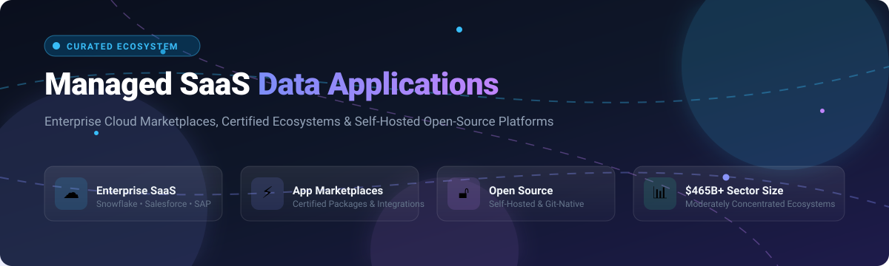

  

# 🚀 Awesome Managed SaaS Data Applications 

> 🌟 A curated list of notable **Managed SaaS Data Applications**, enterprise cloud marketplaces, certified partner ecosystems, and high-performance open-source self-hosted alternatives.

---

## 📈 Sector Overview & Market Dynamics

The global Software-as-a-Service (SaaS) and managed cloud data application market is estimated at **$408B – $465B in 2025–2026**, on a steady trajectory to surpass **$500B** by 2027 with a ~18% CAGR. 

The sector exhibits **moderate concentration with strong network effects**: while thousands of niche vertical SaaS applications proliferate across functional domains, the underlying data applications and managed marketplace layers are anchored by category titans (such as Oracle, SAP, Salesforce, ServiceNow, Adobe, and Snowflake). In these ecosystems, platform winners capture dominant gross merchandise value (GMV) and enterprise retention through proprietary certification programs, developer lock-in, and pre-integrated AppExchange/Store distribution channels.

---

## 📑 Table of Contents

- [📈 Sector Overview & Market Dynamics](#-sector-overview--market-dynamics)
- [☁️ SaaS & Hosted Platforms](#️-saas--hosted-platforms)
- [🔓 Open-Source GitHub Projects](#-open-source-github-projects)
- [🤝 How to Contribute](#-how-to-contribute)
- [💖 Support](#-support)
- [⭐ Star History](#-star-history)
- [⚠️ Disclaimer](#️-disclaimer)

---

## ☁️ SaaS & Hosted Platforms

The table below outlines category-defining managed SaaS data platforms, their company scale (sorted in descending order by market valuation / enterprise scale), pricing models, and free access limits.

| 🏢 Platform | 💰 Company Valuation / Revenue | 🏷️ Starting Pricing Tier | 🎁 Free Tier / Trial Limit | 🧩 Ecosystem Highlights |
|:---|:---|:---|:---|:---|
| **[NetSuite](https://www.netsuite.com/)** (Oracle) | **~$360B** Market Cap *(Oracle FY25 Rev: $53B)* | **$999/month** base platform fee + **$99/user/month** | **No ongoing free tier**; 14-day guided product demo/trial available upon sales qualification | SuiteApp Marketplace with managed updates, automated SDN partner certification, and native ERP data structures. |
| **[SAP Cloud / Store](https://store.sap.com/)** | **~$280B** Market Cap *(FY24 Rev: €31B)* | **€1,350/tenant/month** (SAP BTP Standard tier entry) | **Free tier on SAP BTP**: Up to 30 service instances indefinitely; 90-day global enterprise trial | SAP Store featuring Spotlight+ certified clean-core extensions and enterprise workflow integrations. |
| **[Salesforce AppExchange](https://appexchange.salesforce.com/)** | **~$270B** Market Cap *(FY25 Rev: $38B)* | **$25/user/month** (Starter Suite / Sales Essentials) | **Free lifetime Developer Edition org**; 30-day full-featured free trial for Sales & Service Cloud | Gold standard enterprise marketplace with locked-component upgradeable managed packages and security reviews. |
| **[Adobe Experience Cloud](https://exchange.adobe.com/)** | **~$200B** Market Cap *(FY24 Rev: $21.5B)* | **$1,250/month** (Adobe Experience Manager Foundations) | **No free tier**; 7-day to 30-day sandbox trials provided strictly for verified enterprise partners | Exchange marketplace for digital marketing integrations, real-time CDP extensions, and customer journey orchestration. |
| **[ServiceNow Store](https://store.servicenow.com/)** | **~$190B** Market Cap *(FY24 Rev: $11B)* | **$100/user/month** (ITSM Professional starting estimate) | **Free lifetime Personal Developer Instance (PDI)** (hibernates after 10 days idle); 90-day store app trials on sub-prod | Now Platform store requiring mandatory compatibility, performance, and security testing for every vendor app. |
| **[Workday Marketplace](https://marketplace.workday.com/)** | **~$68B** Market Cap *(FY25 Rev: $8.4B)* | **$100/employee/month** (Core HCM entry bundle) | **No self-serve free tier**; 30-day structured sandbox environment for qualified prospective enterprise accounts | Certified AI agents, financial applications, and HR planning extensions verified on the Workday platform. |
| **[Snowflake Managed Apps](https://www.snowflake.com/)** | **~$55B** Market Cap *(FY25 Rev: $3.6B)* | **$2.00/credit** (Standard Edition compute & storage) | **30-day free trial** with **$400 in complimentary usage credits** | Snowflake Marketplace hosting Native Apps and provider-managed compute environments with zero data movement. |
| **[Atlassian Cloud](https://marketplace.atlassian.com/)** | **~$45B** Market Cap *(FY24 Rev: $4.4B)* | **$7.75/user/month** (Jira Software Standard) | **Free forever plan** for up to **10 users** and 2 GB cloud storage; 7-day to 30-day trials for higher tiers | 5,000+ Marketplace apps across Jira, Confluence, and Bitbucket with Standard and Advanced version tiers. |
| **[HubSpot App Marketplace](https://www.hubspot.com/apps)** | **~$30B** Market Cap *(FY24 Rev: $2.6B)* | **$15/seat/month** (HubSpot Starter Customer Platform) | **Free forever plan** with basic CRM, up to 5 email templates, 1 shared inbox, and 1,000 marketing contacts | Over 1,500 turnkey marketplace integrations with bi-directional data synchronization and workflow webhooks. |
| **[Zendesk Marketplace](https://www.zendesk.com/apps/)** | **~$10.2B** Acquired / Valuation *(FY24 Rev: ~$2.1B)* | **$19/agent/month** (Support Team plan) | **14-day fully-featured free trial** with complete multi-channel support features | The second largest SaaS marketplace featuring 1,500+ apps powering customer service, omni-channel workflows, and QA. |

---

## 🔓 Open-Source GitHub Projects

The following open-source projects provide powerful self-hosted alternatives, internal tool frameworks, and data application engines. They are ranked in descending order by community GitHub_Stars.

| 📦 Repository & Project | ⭐ GitHub_Stars | ⚖️ License | 🎯 Target & Functional Focus |
|:---|:---|:---|:---|
| **[NocoDB](https://github.com/nocodb/nocodb)** |  | AGPL-3.0 | 📊 **Smart Spreadsheet & Airtable Alternative** — Turns any relational database (PostgreSQL, MySQL, SQL Server) into a no-code collaborative data application platform with REST APIs and webhooks. |
| **[Twenty](https://github.com/twentyhq/twenty)** |  | AGPL-3.0 | 🤝 **Modern CRM & Salesforce Alternative** — Fully open-source CRM featuring Model Context Protocol (MCP) server integration, native GraphQL APIs, Docker/K8s deployment, and zero vendor lock-in. |
| **[Appsmith](https://github.com/appsmithorg/appsmith)** |  | Apache-2.0 | 🛠️ **Internal Application Builder** — Drag-and-drop low-code engine for creating complex admin panels, database CRUD applications, and business workflows connecting to 25+ data sources. |
| **[ToolJet](https://github.com/ToolJet/ToolJet)** |  | AGPL-3.0 | 🤖 **AI-Native Enterprise App Platform** — Low-code visual application framework with native AI agent integration, MCP connectivity, and support for enterprise internal tools. |
| **[ERPNext](https://github.com/frappe/erpnext)** |  | GPL-3.0 | 🏭 **Enterprise Resource Planning (ERP)** — Comprehensive NetSuite / SAP alternative offering modules for accounting, inventory, supply chain, manufacturing, HR, and CRM on the Frappe framework. |
| **[Chatwoot](https://github.com/chatwoot/chatwoot)** |  | AGPL-3.0 | 💬 **Customer Engagement & Helpdesk Suite** — Open-source Zendesk and Intercom alternative providing omnichannel inbox management (Email, WhatsApp, SMS, Web Chat) with deep CRM connectivity. |
| **[Budibase](https://github.com/Budibase/budibase)** |  | GPL-3.0 | ⚡ **Operations Automation & Portal Builder** — Self-hostable low-code platform to build internal data tools, forms, approvals, and portal interfaces on top of SQL, MongoDB, and REST APIs. |
| **[GLPI](https://github.com/glpi-project/glpi)** |  | GPL-3.0 | 💻 **IT Service Management (ITSM)** — Self-hosted ServiceNow alternative featuring ITIL-compliant service desk, automated asset discovery, datacenter infrastructure management, and license tracking. |
| **[EspoCRM](https://github.com/espocrm/espocrm)** |  | GPL-3.0 | 📇 **Lightweight Business CRM** — Responsive single-page application CRM to track leads, opportunities, sales accounts, and automated business workflows. |
| **[FreeITSM](https://github.com/edmozley/freeitsm)** |  | MIT | 🎫 **Lightweight Service Desk** — Minimalist open-source IT service management tool designed for small teams and MSPs, complete with Active Directory sync and multi-tenant support. |
| **[Hermit CRM](https://github.com/Hermit-CRM/hermit-crm)** |  | Apache-2.0 | 📁 **Git-Native & Markdown CRM** — Local-first CRM storing every customer and interaction as Markdown files in Git, complete with an embedded MCP server for LLM assistants. |

> 💡 **Architectural Note on Open-Source vs. Managed Ecosystems**:  
> Open-source projects deliver outstanding self-hosted alternatives to the **core functional applications** (CRM, ERP, ITSM, and App Builders). However, commercial SaaS titans uniquely provide **global certified marketplaces** (e.g., Salesforce AppExchange, ServiceNow Store) with automated tenant provisioning, cryptographic code locking, and centralized billing. Choose open-source when data sovereignty, cost control, and self-hosting flexibility matter most; choose managed platforms when you require pre-certified enterprise partner ecosystems.

---

## 🤝 How to Contribute

Contributions are warmly welcomed! Help keep this ecosystem guide up-to-date:

1. 🍴 Fork the repository.
2. 🌿 Create a descriptive branch: `git checkout -b add-awesome-data-app`.
3. 📝 Update `README.md` following the tabular format and guidelines:
   - Provide verified starting tier pricing and specific trial / free tier terms.
   - For open-source repos, verify the repository license and GitHub Stars_Badge format.
4. 🚀 Push your changes and submit a Pull Request with a clear description of additions.

---

## 💖 Support

Thank you for visiting and using this curated directory! If you find this resource helpful, please consider supporting the project:

- ⭐ **Star this repository** to show appreciation and boost visibility.
- 🍴 **Fork and share** it with your fellow engineers, architects, and community.
- ☕ **Buy me a coffee**: Support continued open-source curation and maintenance via the [GitHub Sponsors Dashboard](https://github.com/sponsors/ishandutta2007).

---

## 📊 Star History

---

## ⚠️ Disclaimer

- This curated list is maintained for architectural research and educational benchmarking.
- Pricing, packaging, and commercial terms are subject to change by respective vendors. Always review official vendor documentation for up-to-date licensing terms.
- Self-hosted open-source software places complete operational responsibility (security hardening, backup policies, compliance, and disaster recovery) on the infrastructure operator.

---

  <b>Curated with ❤️ for platform architects, enterprise engineers, and open-source advocates.</b> 
  Found this guide valuable? Please consider giving it a ⭐ on GitHub!

